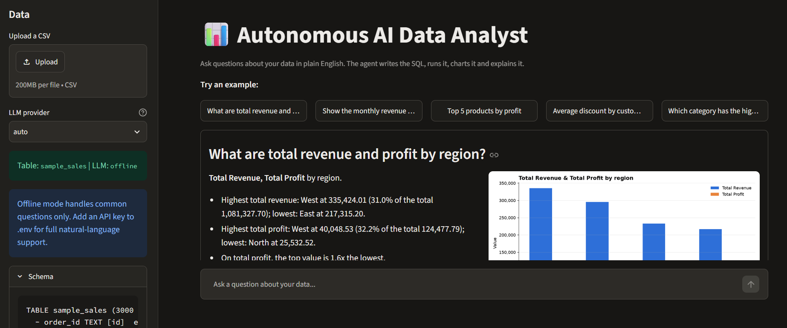
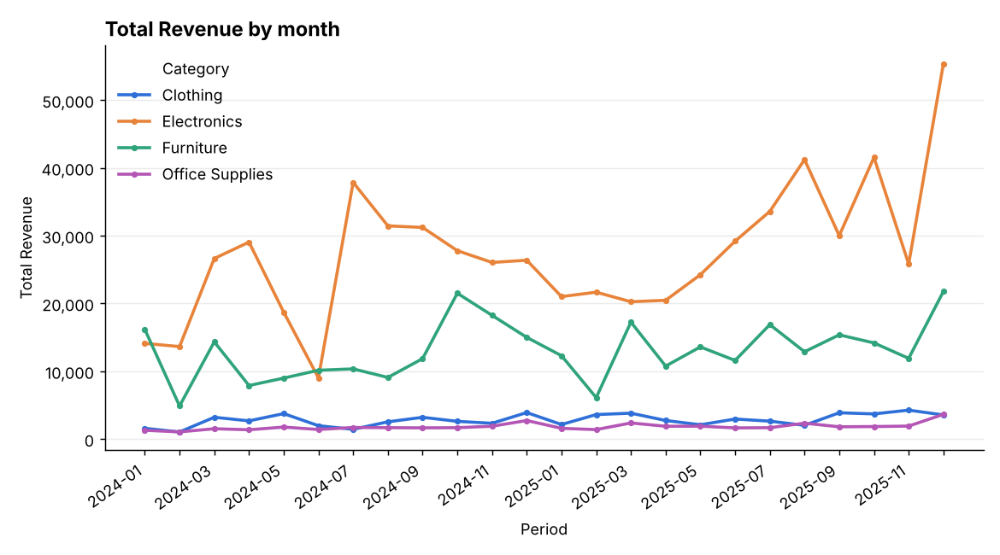
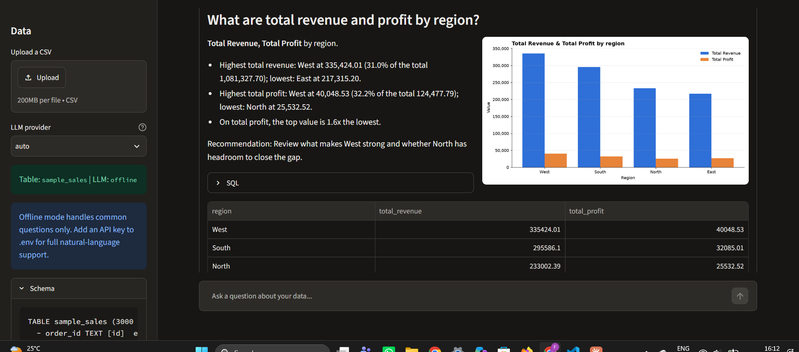
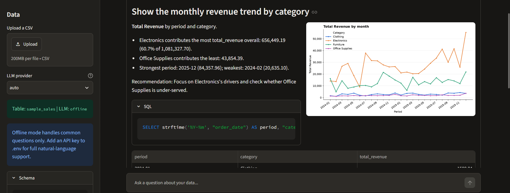
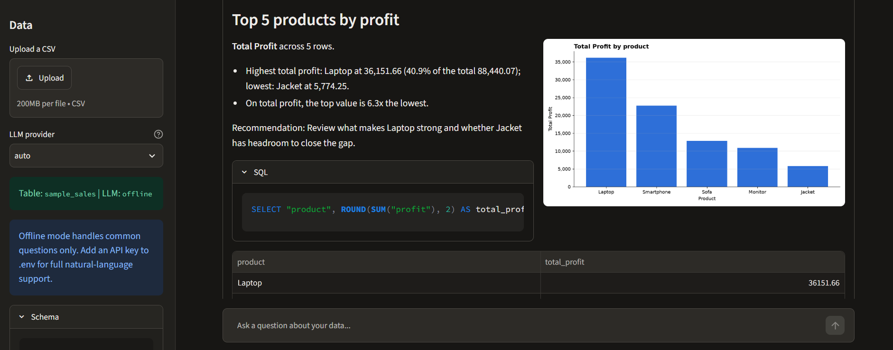

# Autonomous AI Data Analyst

Ask questions about a dataset in plain English. An LLM-driven agent writes the SQL, runs it safely, fixes its own mistakes, draws a chart and explains the result in business terms.

**Stack:** Python · SQL (SQLite) · LLMs (Claude / OpenAI) · AI agents · pandas · matplotlib · Streamlit

    



## What it does

```
 "Which region earns the most profit?"
            │
            ▼
   ┌──────────────────┐   schema + sample values + chat history
   │  1. PLAN (LLM)   │◄──────────────────────────────────────────┐
   │  question → SQL  │                                           │
   │  + chart spec    │                                           │
   └────────┬─────────┘                                           │
            ▼                                                     │
   ┌──────────────────┐   rejected / SQL error                    │
   │  2. VALIDATE+RUN │──────────────────────────► feedback ──────┘
   │  SELECT-only     │   (self-correction loop, max 3 tries)
   │  guard + read-   │
   │  only engine     │
   └────────┬─────────┘
            ▼
   ┌──────────────────┐   ┌──────────────────┐
   │  3. CHART        │   │  4. SUMMARISE    │
   │  bar/line/pie/   │   │  findings +      │
   │  scatter/hist    │   │  recommendation  │
   └──────────────────┘   └──────────────────┘
```

- **Natural-language → SQL.** The model sees the schema, sample values and your earlier questions, so follow-ups like "now break that down by month" work.
- **Self-correcting.** If the SQL fails or is rejected, the error is sent back to the model for another attempt.
- **Safe by construction.** Two independent layers: a static guard (single `SELECT`/`WITH` statement, forbidden keywords, automatic row cap) and a SQLite authorizer that refuses any write at engine level.
- **Automatic visualisation.** The model proposes a chart; invalid specs fall back to a heuristic (time → line, category → bar, two numbers → scatter).
- **Business insights.** A short summary with a direct answer, key findings quoting real numbers and one recommendation.
- **Runs without an API key.** An offline rule-based mode answers common questions (totals, averages, counts, top-N, trends by day/week/month/quarter/year) so you can try everything before connecting an LLM.



## Screenshots

Each answer shows a plain-English summary, an automatic chart, the SQL the agent wrote (expandable) and the full result table.

**Revenue and profit by region** (two measures compared side by side)


**Monthly revenue trend by category** (time series, one line per category, with the generated SQL)


**Top 5 products by profit** (ranking with findings and a recommendation)


## Quick start

```bash
git clone https://github.com/Fariha12t/autonomous-ai-data-analyst-agent.git
cd autonomous-ai-data-analyst-agent
python -m venv .venv
source .venv/bin/activate          # Windows PowerShell: .venv\Scripts\Activate.ps1
pip install -r requirements.txt

# optional: connect an LLM (otherwise the offline demo mode is used)
cp .env.example .env        # then add ANTHROPIC_API_KEY (or OPENAI_API_KEY)

streamlit run app.py        # web UI
python main.py ask "What are total revenue and profit by region?"   # CLI
python main.py chat         # interactive CLI session
```

The repo ships with `data/sample_sales.csv` (3,000 synthetic orders, 2024–2025). Regenerate it with `python scripts/generate_sample_data.py`.

### Use your own data

- **Web UI:** upload a CSV in the sidebar.
- **CLI:** `python main.py ask "..." --csv path/to/file.csv` (repeat `--csv` for several tables; the file name becomes the table name).

### CLI options

| Flag | Meaning |
|---|---|
| `--csv PATH` | CSV to load (repeatable). Default: sample sales data |
| `--provider anthropic\|openai\|offline` | LLM backend. Default: auto-detect from environment |
| `--report` | Also save a Markdown report (summary, SQL, data) next to the chart in `outputs/` |

## Example questions (sample data)

- What are total revenue and profit by region?
- Show the monthly revenue trend by category
- Top 5 products by profit
- Average discount by customer segment
- How many orders per quarter?

With an LLM connected you can ask anything the schema supports, e.g. *"Which categories lose margin when discount exceeds 10%?"* or *"Compare Q4 2025 to Q4 2024 revenue by region."*

## Configuration

Set in `.env` (see `.env.example`):

| Variable | Default | Purpose |
|---|---|---|
| `LLM_PROVIDER` | `auto` | `anthropic`, `openai`, `offline` or `auto` |
| `ANTHROPIC_API_KEY` / `OPENAI_API_KEY` | – | Credentials |
| `ANTHROPIC_MODEL` | `claude-sonnet-5-5` | Model for Anthropic |
| `OPENAI_MODEL` | `gpt-4o` | Model for OpenAI |
| `MAX_ROWS` | `500` | Row cap on every query |
| `MAX_RETRIES` | `3` | Self-correction attempts |
| `MAX_ROWS_TO_LLM` | `30` | Result rows sent to the LLM for the summary |

> **Privacy note:** with a hosted LLM, the schema, a few sample values per column and up to `MAX_ROWS_TO_LLM` result rows are sent to the provider. Use the offline mode, or lower that limit, for sensitive data.

## Project structure

```
autonomous-ai-data-analyst-agent/
├── app.py                      # Streamlit UI
├── main.py                     # CLI (ask / chat)
├── ai_data_analyst/
│   ├── agent.py                # orchestration + self-correction loop
│   ├── llm.py                  # Anthropic / OpenAI / offline backends, prompts
│   ├── database.py             # CSV → SQLite, schema profiling, read-only engine
│   ├── sql_guard.py            # static SQL safety checks
│   ├── visualize.py            # chart selection + rendering
│   └── config.py               # settings from environment
├── scripts/generate_sample_data.py
├── data/sample_sales.csv
├── docs/                       # README images and app screenshots
├── tests/                      # 42 tests, no network needed
└── .github/workflows/ci.yml    # runs pytest on every push
```

## Use it as a library

```python
from ai_data_analyst import Database, DataAnalystAgent, load_settings, build_llm

settings = load_settings()                      # auto-detects provider from env
db = Database(max_rows=settings.max_rows)
db.load_csv("data/sample_sales.csv")

agent = DataAnalystAgent(db, build_llm(settings), settings)
result = agent.ask("Top 5 products by profit")

print(result.sql)
print(result.data)
print(result.summary)
print(result.chart_path)
```

## Tests

```bash
pytest -q
```

The suite covers the SQL guard, the engine-level write block, schema profiling, JSON parsing of model replies, the offline planner, chart fallbacks and the agent's retry loop (using a scripted fake LLM, so no API key or network is needed).

## Troubleshooting

| Problem | Fix |
|---|---|
| Sidebar says `LLM: offline` although you set a key | Check `.env` is in the project root, the line is `ANTHROPIC_API_KEY=sk-ant-...` with no `#`, spaces or quotes, then restart the app |
| `credit balance is too low` | The Anthropic API is billed separately from a Claude.ai plan. Add credit in the Anthropic Console, or choose `offline` in the sidebar |
| PowerShell blocks `Activate.ps1` | Run `Set-ExecutionPolicy -Scope CurrentUser RemoteSigned` once, then activate again |
| `python` not recognised | Install Python 3.10+ and tick "Add Python to PATH" (or use `py`) |
| A question returns no chart | The result had a single row or no numeric column; ask for a breakdown (by region, month, ...) |

## Design decisions

- **Read-only by design.** LLM-generated SQL is untrusted input, so it passes a static guard and then runs on a connection whose SQLite authorizer denies every non-read operation.
- **Bounded cost and output.** Row cap on every query, a limit on rows sent to the LLM, and a fixed number of retries.
- **Testable without a network.** The LLM sits behind a small interface; tests use a scripted fake model to exercise the retry loop, and the offline backend makes demos and CI key-free.

## Limitations and next steps

- Offline mode is rule-based and only covers common single-table questions; use an LLM for open-ended analysis.
- SQLite only. Swapping in PostgreSQL/MySQL means replacing `Database` (keep the read-only guard).
- Ideas: multi-step analysis plans (several queries per question), statistical tests, anomaly detection, scheduled reports, an evaluation set of question → expected-SQL pairs.


